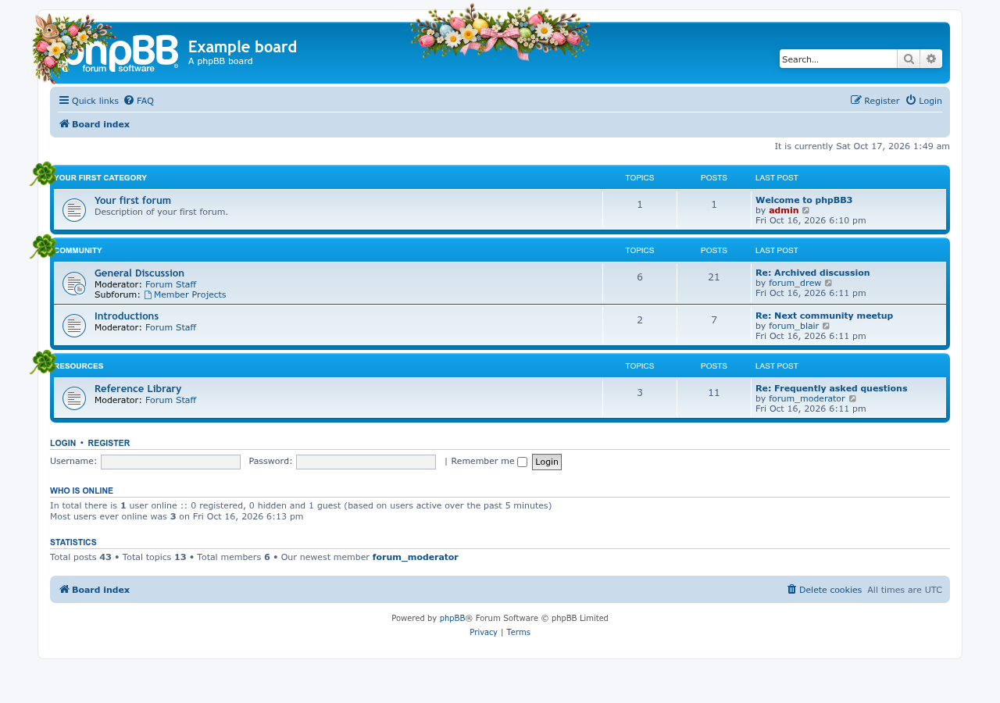
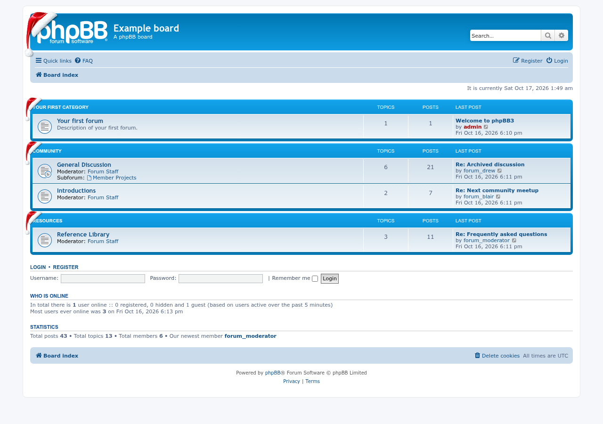
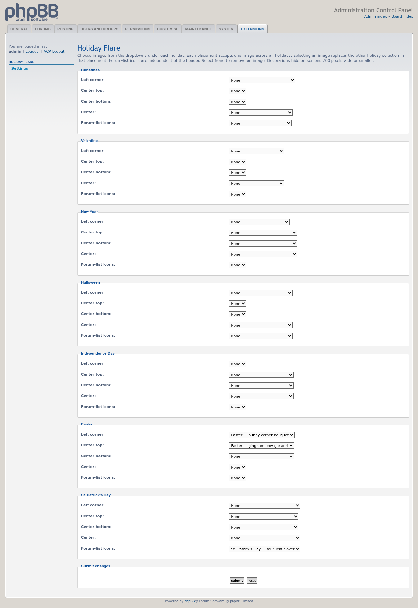

# Holiday Flare

 

Adds selectable holiday decorations to the left corner, header top, header bottom, header center and forum list.

## Features

- Browse image dropdowns grouped by holiday: one image per placement across all holidays, or None.
- Show different holidays together in different placements.
- Each image is offered only in suitable positions, with individually fitted sizes and offsets.
  See the [artwork placement guide](docs/image-placement-guide.md).
- Includes Christmas, Valentine, New Year, Halloween, Independence Day, Easter and St. Patrick’s Day artwork.
- Select Christmas hats or pumpkin variants independently for the forum list.
- Decorations hide on screens 700 pixels wide or smaller.
- Existing theme selections carry over during upgrade, preserving the previously visible theme.
- Supported styles: prosilver, Green-Style-Slim, pro_ubuntu_lucid and proflat.

## Screenshots

Easter header artwork with independent St. Patrick’s Day clover forum icons.

The original Christmas hat and independently selected forum-list hats.

Full ACP settings: seven holiday groups and five independent placements.

[View the screenshot gallery](docs/images/screenshots/README.md).

## Requirements

- phpBB 3.3.19 or later
- PHP 7.4 or later

## Installation

1. Copy the extension to `/ext/phpbbmodders/holidayflare`
2. In the Administration Control Panel, go to **Customise → Manage extensions**
3. Enable the **Holiday Flare** extension
4. Under **ACP → Extensions → Holiday Flare → Settings**, browse the holiday groups and choose images from the dropdowns for *Left corner*, *Center top*, *Center bottom*, *Center* and *Forum-list icons*, then submit

## Contributing

Contributions are welcome!

- **Bug reports**: [Open an issue](https://github.com/phpbbmodders/holiday_flare/issues).
- **Everything else** (questions, feature requests, ideas, general discussion): [Use Discussions](https://github.com/orgs/phpbbmodders/discussions), or the [community forum](https://www.phpbbmodders.com/community/). The [phpBB.com support thread](https://www.phpbb.com/community/viewtopic.php?f=456&t=2277491) is still open too.
- Pull requests are welcome for bug fixes or discussed features.

## Acknowledgments

- Converted to a phpBB extension by Matt Friedman ([MattF](https://www.phpbb.com/customise/db/author/mattf)).
- The Valentine's Day theme was originally contributed by [TWEagle](https://github.com/TWEagle).
- The jQuery-based header banner was originally contributed by Rich McGirr ([rmcgirr83](https://github.com/rmcgirr83)), extended to additional styles by Raphaël M. ([Galixte](https://github.com/Galixte)).
- French translation by Raphaël M. ([Galixte](https://github.com/Galixte)); Arabic translation by Basil Taha Alhitary.
- Modernization (current PHP/phpBB version support, a real bug fix confirmed against a live phpBB install, reconciling several long-open pull requests, and this documentation) assisted by [Claude](https://www.anthropic.com/claude).
- Decoration selectors, image preparation and validation assisted by [Codex](https://www.anthropic.com/Codex).

## License

This extension is licensed under the **GNU General Public License v2.0**.

See [license.txt](license.txt) for more information.
