# Holiday Flare screenshots

Captured with Playwright on seeded Example boards using bundled Prosilver.
The original examples below use phpBB 3.3.19. Additional galleries show each
holiday separately on phpBB 3.3.19 and phpBB 4.0.0-a3-dev.

Easter header artwork with independent St. Patrick’s Day clover forum icons.

The original Christmas hat and independently selected forum-list hats.

Full ACP settings: seven holiday groups and five independent placements.

## phpBB 3.3.19 — individual holidays

### Christmas

Corner ribbon and independent forum-list Santa hats.

[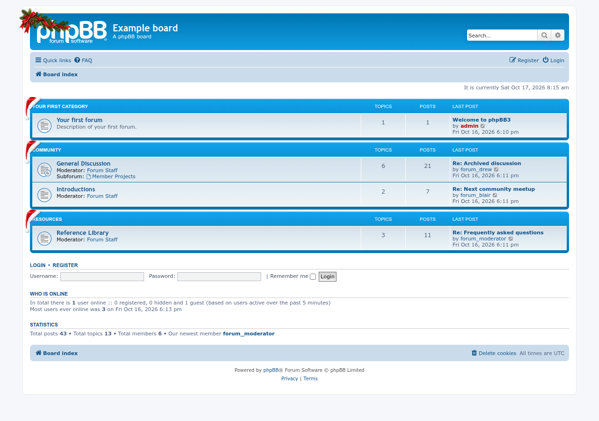](phpbb-3.3/holiday-flare-christmas.png)

### Valentine’s Day

Valentine heart in the left corner.

[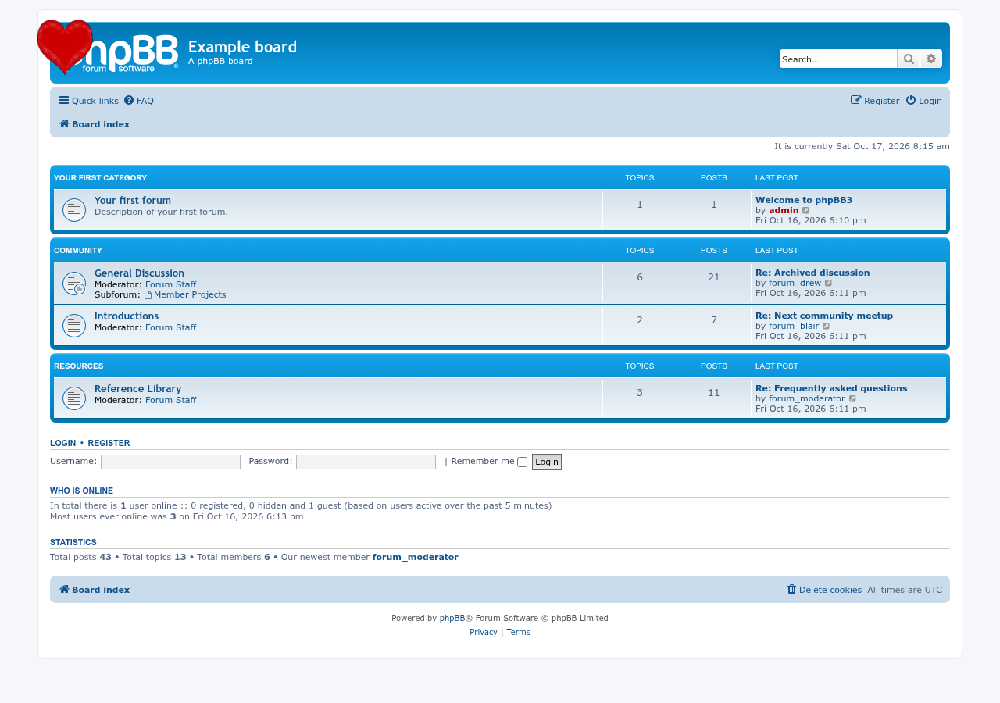](phpbb-3.3/holiday-flare-valentine.png)

### New Year

New Year greeting in the corner and midnight artwork in the center.

[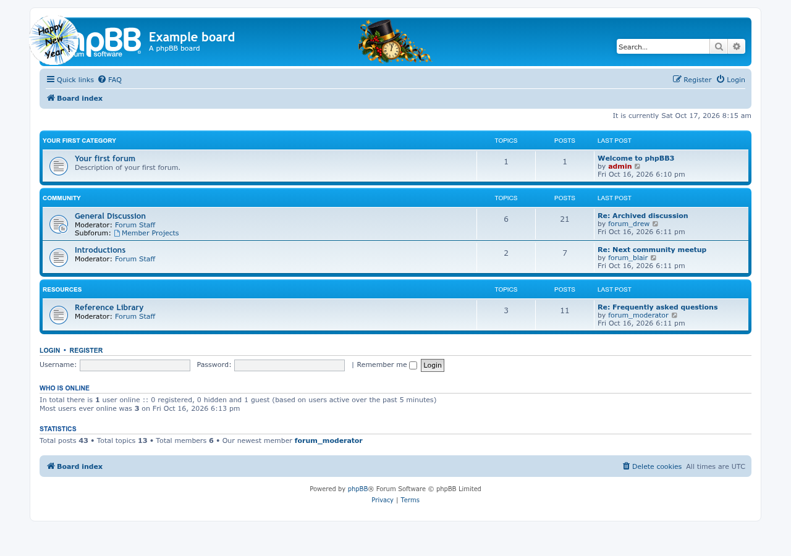](phpbb-3.3/holiday-flare-newyear.png)

### Halloween

Autumn pumpkin in the corner and pumpkins on the forum list.

[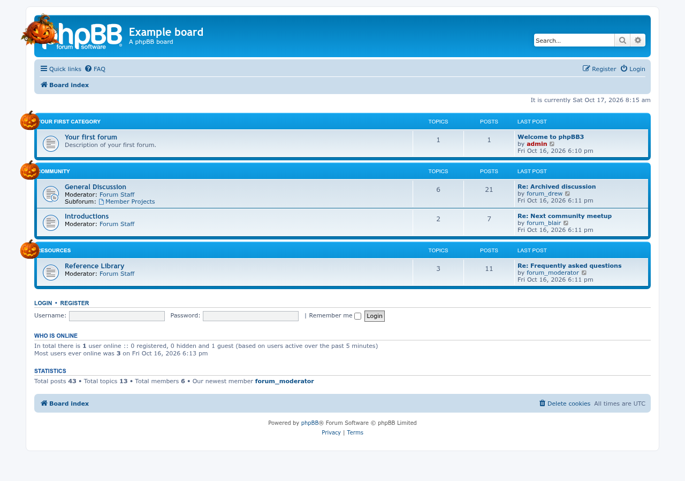](phpbb-3.3/holiday-flare-halloween.png)

### Independence Day

Patriotic fireworks centered over the banner.

[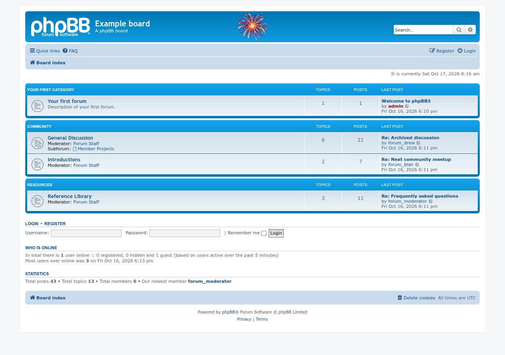](phpbb-3.3/holiday-flare-independence.png)

### Easter

Bunny bouquet in the corner and an Easter garland at the bottom of the banner.

[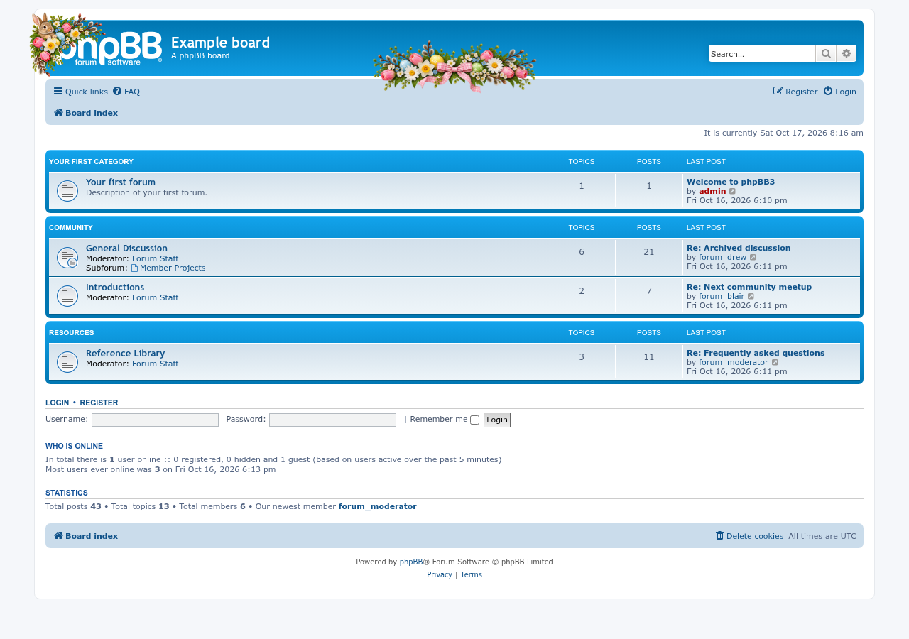](phpbb-3.3/holiday-flare-easter.png)

### St. Patrick’s Day

Corner hat, bottom clover garland and clovers on the forum list.

[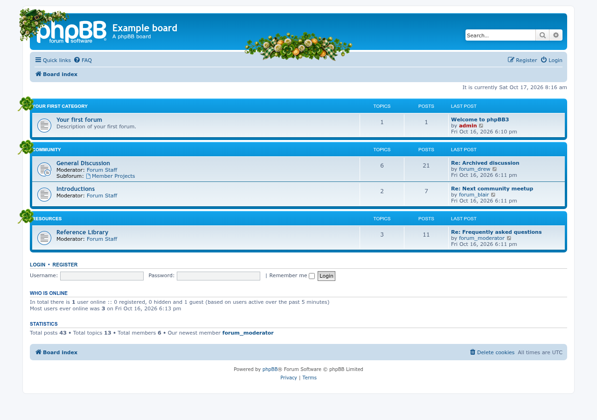](phpbb-3.3/holiday-flare-stpatrick.png)

## phpBB 4.0.0-a3-dev — individual holidays

### Christmas

Corner ribbon and independent forum-list Santa hats.

[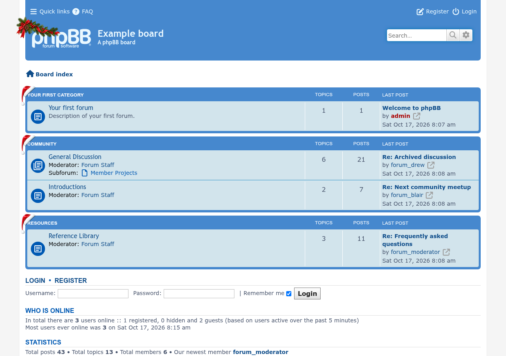](phpbb-4.0/holiday-flare-christmas.png)

### Valentine’s Day

Valentine heart in the left corner.

### New Year

New Year greeting in the corner and midnight artwork in the center.

[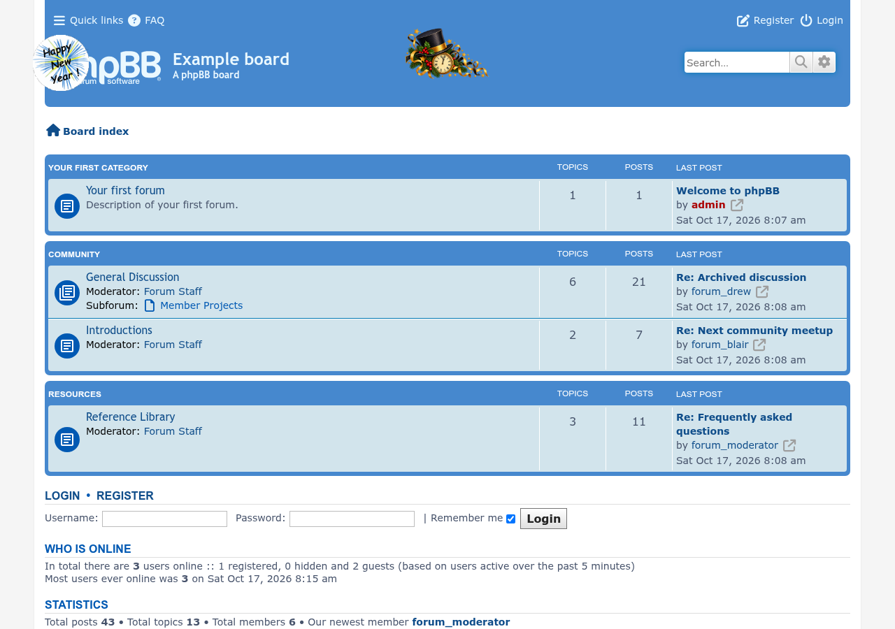](phpbb-4.0/holiday-flare-newyear.png)

### Halloween

Autumn pumpkin in the corner and pumpkins on the forum list.

[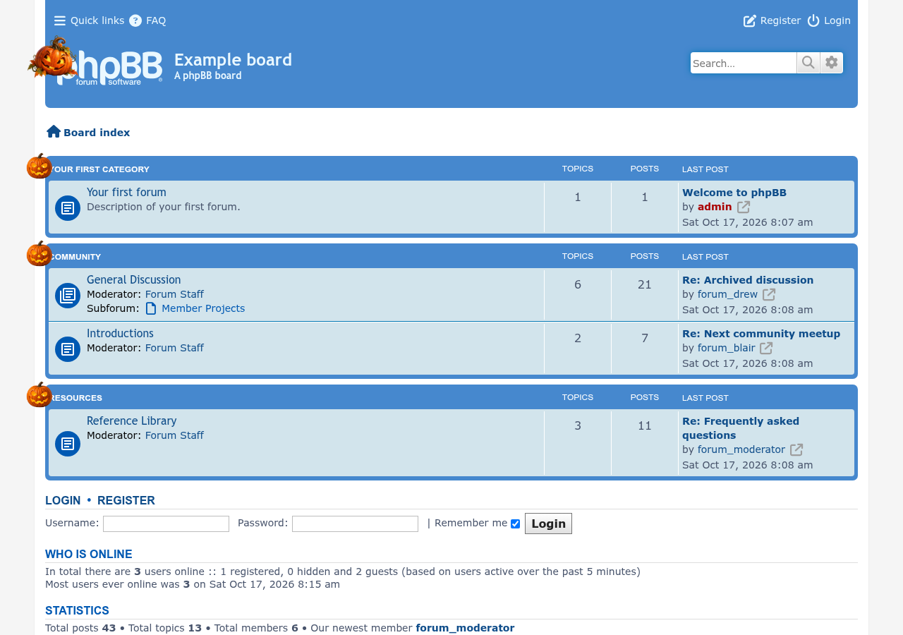](phpbb-4.0/holiday-flare-halloween.png)

### Independence Day

Patriotic fireworks centered over the banner.

[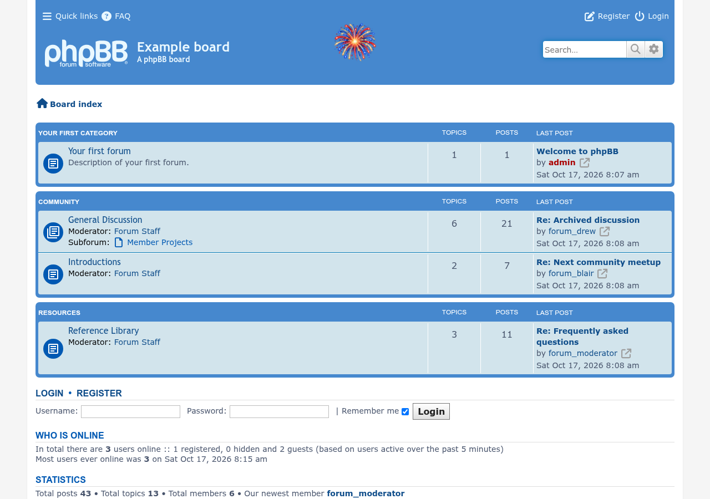](phpbb-4.0/holiday-flare-independence.png)

### Easter

Bunny bouquet in the corner and an Easter garland at the bottom of the banner.

[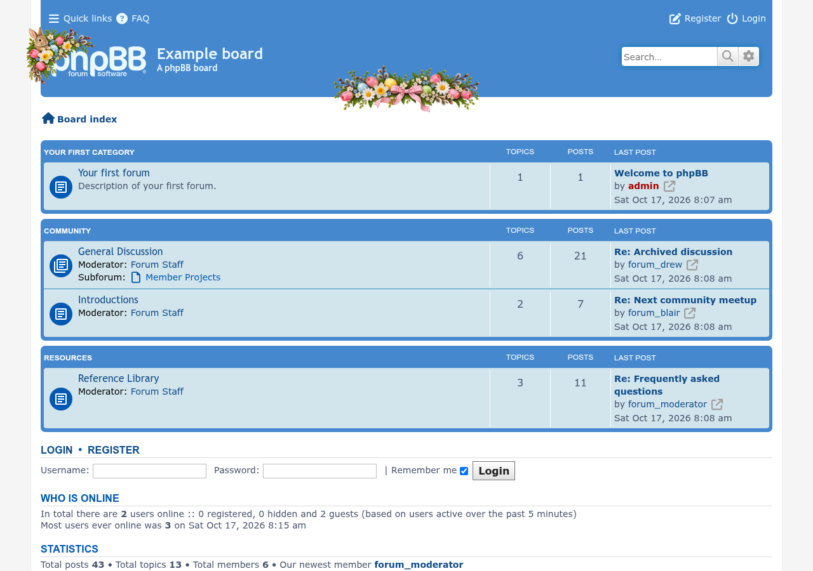](phpbb-4.0/holiday-flare-easter.png)

### St. Patrick’s Day

Corner hat, bottom clover garland and clovers on the forum list.

[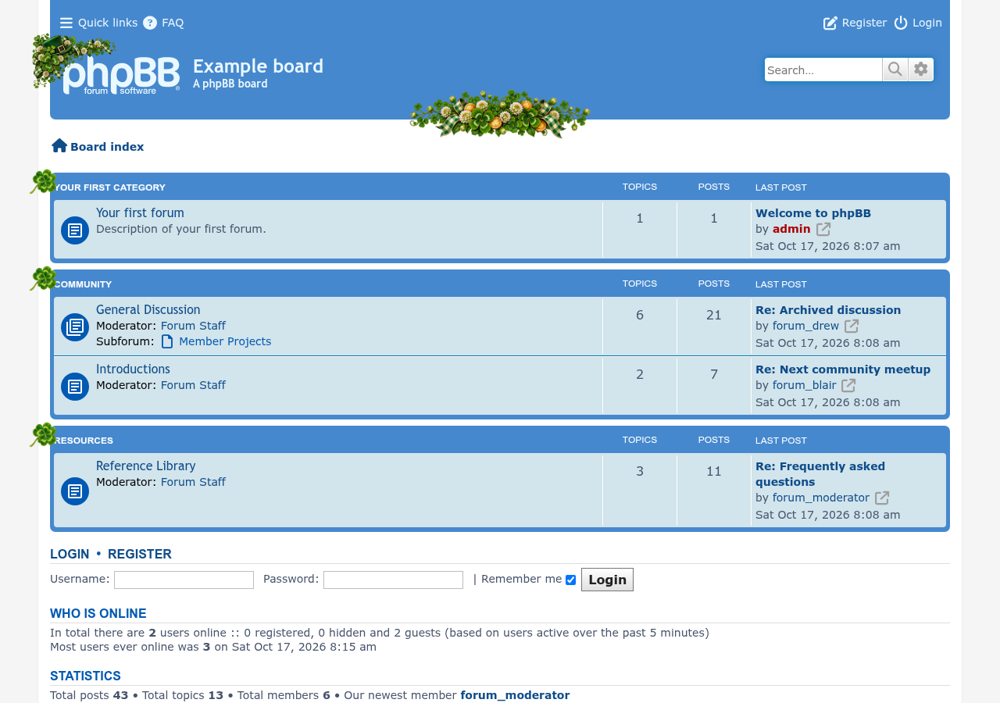](phpbb-4.0/holiday-flare-stpatrick.png)
